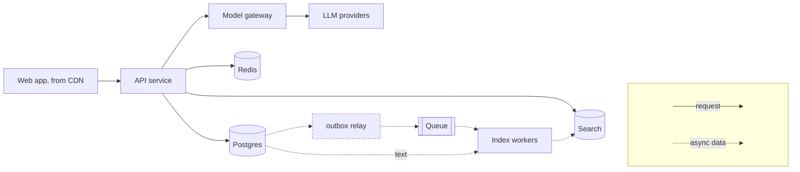

# Proposed production infrastructure

**Scope.** For lawyers working on contracts, we scale what is built† (search, viewing, redlining, suggestions and query expansion on Claude, indexing), adding persistence, sign-in, permissions, locks and audit, then what larger firms expect, in our cloud.

**Priorities:** never lose an edit > firm isolation > fast lawyer loop > fresh search > bounded model spend > availability > cost.

| Tier     | Assumes                                   | Product and platform                                                                                                                                   |
| -------- | ----------------------------------------- | ------------------------------------------------------------------------------------------------------------------------------------------------------ |
| Pilot    | 1–3 firms, 50 lawyers, 10k docs, 1 region | The features† made durable: Postgres, SSO, roles, locks, audit; the BM25 index† as one search service (~6 GB of RAM); SOC 2 T1\* |
| Growth   | ~20 firms, ~2k lawyers, 1–5M docs         | Firm onboarding, API clients; OpenSearch; services split; SOC 2 T2\*                                                                                   |
| Platform | 100+ firms, 10k lawyers, 10M docs         | Residency regions\*, dedicated stacks, Kubernetes, Postgres split by firm                                                                              |

**Where search jumps to OpenSearch:** the BM25 index† isn't persisted; it measured ~6× the text in memory, documents included, at ~100 KB per doc and ~1 s per 10 MB to build. Pilot's ~1 GB needs ~6 GB of RAM and 1–2 minutes to rebuild; Growth's hundreds of GB would need TBs and hours. Postgres full-text search is instant and already there but ranks worse and loads the main database. OpenSearch is an open-source search engine: a cluster that keeps each index on disk, split across nodes with replicas, updated per document. Bought managed: patching, snapshots and failed nodes aren't our edge.

**Architecture.**

- **Services:** one API service† (documents, redlines, search, suggestions). Commits write an "index this" row (an outbox) in their transaction; index workers, separate containers scaled by queue depth, reindex the documents, coalescing edits†.
- **Hosting:** containers behind a load balancer, off Vercel, which caps request bodies at 4.5 MB (documents run 10 MB+), weakens ETags (#38), likely stalls reindexing (#39), and limits our control of residency, networking and keys. Managed containers, then managed Kubernetes once regions and dedicated stacks multiply: more to operate.
- **Frontend:** a static bundle on the CDN, cached per release. It renders only the visible part of a long document, via API range reads, and server push replaces the UI's 500 ms re-polling†, real load at 2k lawyers.
- **Data:** Postgres (documents, history, permissions, locks), per-firm row-level security; replicas; editors read the primary.
- **Consistency:** search is eventual†, keeping commits fast, as the loop outranks freshness; instant would hold each commit.
- **Locks:** one lawyer edits at a time, others see who; locks expire; admins override, keeping the overridden draft; `If-Match` required; firms set policy (#37).
- **Model gateway:** one interface to any provider, a model per task†. Direct structured-output calls† are cheap, fast and testable, and fit today's one-call tasks. If it fails, search runs unexpanded; lawyers edit by hand†.

**CI/CD.** Tests† replay recorded model calls (free, repeatable, blind to drift); evals† run by hand. Recorded evals gate CI (#31); live nightly evals catch drift; load and browser tests gate releases. Canaries auto-roll back; DB changes work with the prior release.

**Security and compliance.** Per-firm SSO (SAML or OIDC); OAuth2 for API clients. Roles (viewer, editor, matter admin, firm admin), per-matter access and ethical walls are enforced in API and search, so hits and the model see only what the user can. TLS; vaulted, rotated secrets; encryption at rest (per-firm keys when dedicated); append-only audit of edits, reads, permission changes, overrides and model calls. SOC 2/GDPR: processing agreements, legal-hold-aware deletion, no provider retention.

**Scalability and resilience.** The API scales on CPU, as model waits cost Node little. A synchronous standby in another zone loses no edit but slows writes; an async replica in another region loses seconds if a region fails, costing a standing replica. Per-firm rate limits in Redis curb noisy neighbours. One service holds until loads diverge, likely at Growth; then search, model calls, and sign-in and permission checks split out to scale and fail alone, at the cost of hops and more to deploy, secure and operate.

**Observability.** Request ids† → e2e traces (OpenTelemetry → Datadog); dashboards by firm vs targets; logs omit contract text†. Alerts: unexpanded search p95 >300 ms, expansion errors or timeouts, edits unsearchable >5 s, failed writes, 80% of budget.

**Operations and cost.** Model calls are the variable cost: ~$0.0001 per expansion† and ~$0.003–0.01 per suggestion in production. Per-firm budgets and an expansion cache in Redis replace the per-instance cap and cache†. Search is the main fixed cost; an index per firm adds shards, as isolation outranks cost. Workers scale to zero; the baseline is reserved.

**Out of scope, to consider:** PDF and .docx (sandboxed import, offset maps); on-prem (same images, customer keys); live co-editing (far costlier than locks); agents (a framework or our own harness) for long-running work needing memory and context management; self-hosted or fine-tuned models behind the gateway, once cheaper than frontier APIs.

† exists in the repo today; everything else is proposed.&emsp;&emsp;\* Compliance timing is an assumption to confirm with buyers.
